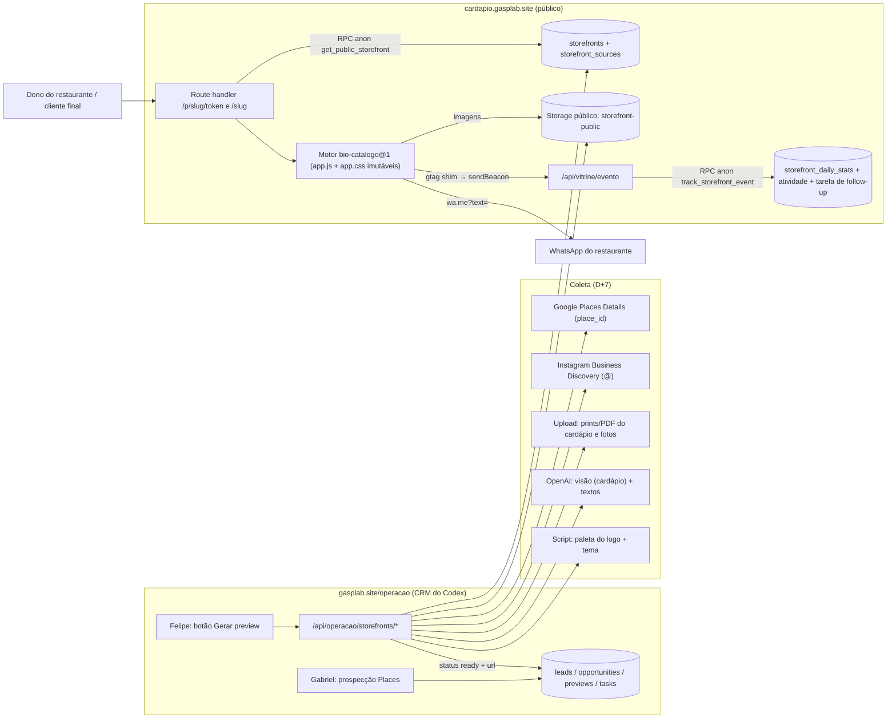
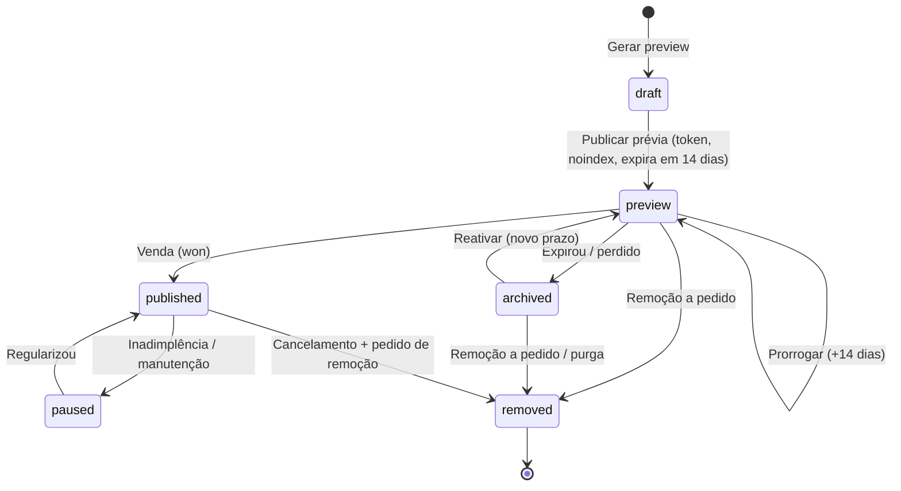

# Arquitetura: previews de Bio + Catálogo em massa (e sites locais)

> **Autor:** aiox-architect (Aria) · **Data:** 01/10/2026 · **Status:** proposta para decisão do Felipe
> **Escopo:** somente GaspLab. Este documento é só leitura sobre o sistema do Codex (nada foi editado nem migrado).
> **Convenções da base:** **estimativa** = número calculado por mim, não medido; **a confirmar** = dado interno não verificado.

---

## 0. Resumo executivo

**Recomendação (3 linhas):**
1. **Um único app multi-tenant** (o Next.js 16 que já existe, em um grupo de rotas isolado) serve todas as vitrines num host dedicado (sugestão: `cardapio.gasplab.site`), com rota por caminho: prévia em `/p/{slug}/{token}` e cliente em `/{slug}` (ou no domínio próprio dele). Hospedagem na **Vercel Pro**, porque o plano Hobby proíbe uso comercial.
2. **Não reescrever o front:** os dois exemplos já rodam o **mesmo motor** (o `app.js` de 54 KB e o `app.css` de 27 KB são idênticos byte a byte, mesmo md5). O que muda entre restaurantes é um JSON (`<script id="config">`), cerca de 30 tokens CSS e as imagens. O renderer só monta esse HTML com o JSON vindo do Supabase (tabela nova `storefronts`) e serve o motor como arquivo estático versionado.
3. **A produção vira um pipeline:** Places, Instagram oficial, prints do cardápio, extração com visão (OpenAI), paleta tirada do logo por script e 4 temas. O humano só coleta as imagens do cardápio e revisa. Tudo fica ligado às tabelas `previews` e `opportunities` do Codex, cujos gatilhos e tarefas já existem.

| # | Decisão | Escolha |
|---|---|---|
| 1 | Renderização | Multi-tenant, um deploy, rota por caminho, motor vanilla reaproveitado |
| 1b | Hospedagem | Vercel **Pro** (trial de 14 dias agora). Dados e imagens no Supabase do Codex |
| 1c | Domínio do cliente | Padrão `cardapio.gasplab.site/{slug}`. Domínio próprio (do cliente, no CPF/CNPJ dele) adicionado via API de domínios da Vercel |
| 2 | Dados | `storefronts.config` (jsonb, validado por zod) + `product_type` na oportunidade + `previews.storefront_id` |
| 3 | Coleta | Automática: Places, IG, paleta, textos, extração. Semiautomática: escolha de fotos, número e revisão. Manual: prints do cardápio |
| 4 | Pedido | `wa.me` com orçamento de ≤1.000 caracteres crus / ≤2.000 codificados, modo compacto e, por último, área de transferência |
| 5 | Ciclo de vida | `draft → preview (token, noindex, 14 dias) → published` ou `archived`/`removed`, espelhado em `previews` e `opportunities` |

**Tempo humano por preview (estimativa):** D0 ≈ 10–12 min · D+3 ≈ 7–9 min · D+7 ≈ 4–6 min (3–4 min com pré-geração em lote).
**Custo mensal (estimativa, 30–60 previews/dia):** D0 ≈ US$ 0–20 · D+3 ≈ US$ 20–45 · D+7 ≈ US$ 65–200 (≈ US$ 0,04–0,12 por preview em APIs).

---

## 1. Ponto de partida

### 1.1 O motor dos exemplos (inspecionado em 01/10/2026)

| Item | Achado |
|---|---|
| Arquivos | `index.html` (config + tokens) + `app.js` + `app.css` + `assets/`. O `app.js` e o `app.css` são **idênticos** no Istambul e no Gênesis (md5 `231d022b…` e `8abb98ac…`) |
| Cabeçalho do `app.js` | "Preview engine — Istambul / Gênesis. Rotas: `#/` (bio) · `#/cardapio[/categoria]` · `#/pedido`. Sem dependências. Config em `<script id="config" type="application/json">`" |
| Chaves do config | `brand`, `whatsapp`, `units[]` (horários, entrega com taxas por km, retirada), `links[]`, `destaque` (`combos` ou `pratoDoDia`), `combos[]`, `pratosDoDia{dia: [ids]}`, `provas` (nota Google, selos, citações), `pedido` (entrega/retirada/pagamentos/troco), `categorias[].itens[]` (preço, `variantes`, `opcoes` com `delta`, `tags`, imagem/thumb) |
| Identidade | ~45 variáveis CSS em `:root` (`--bg`, `--surface`, `--ink`, `--brand`, `--accent`, `--hero-*`, `--font-display`, `--font-ui`, `--radius-*`, `--divider` …), fontes do Google Fonts, `<template id="hero-art">` com SVG decorativo e algumas regras CSS por marca |
| Estado | Carrinho no `localStorage` (`preview:{brand.id}`). Contadores locais. Chama `window.gtag` se existir, o que permite plugar telemetria **sem alterar o motor** |
| Mensagem WhatsApp | `buildMessage()` com itens, subtotal, entrega, total, modalidade, pagamento e troco, nome, obs e assinatura. Se `encodeURIComponent(texto) > 1800`, cai para o modo compacto. Link `https://wa.me/{num}?text=` |
| SEO / meta | `<meta name="robots" content="noindex">` já existe. `og:image` é **relativo** (`assets/og.jpg`), e o WhatsApp exige URL absoluta para mostrar a miniatura |
| Escape de HTML | O texto do config passa por `esc()` antes de entrar no HTML. Mas `esc()` **não bloqueia `javascript:`** em `href`, então as URLs precisam ser validadas no servidor |

**Limitações do motor v1 que bloqueiam escala** (correções no motor 1.1, na história VIT-1.2):
- Horário com **um intervalo por dia** (`["11:00","23:00"]`). Restaurante com almoço e jantar não cabe.
- Sem **virada da meia-noite** (`18:00–02:00` nunca aparece como "aberto").
- **Fuso fixo** `America/Sao_Paulo` (erra em AM, MT, MS, RO, RR e AC). A data da mensagem usa o relógio do aparelho.
- Sem saída para mensagem longa, além do modo compacto.

### 1.2 O que o Codex está construindo (não commitado, somente leitura)

- **Tabelas:** `leads` (`source='google_places'` com `source_reference = place_id`, `do_not_contact`), `contacts`, `opportunities` (estágios `new → contacting → interested → preview_in_production → preview_sent → proposal → won/lost`), `previews` (`requested → in_progress → ready → presented | canceled`, `url` obrigatória em `ready`, 1 ativo por oportunidade), `tasks` (com `automation_key`), `activities` (tipo `preview` já existe), `app_settings`, `knowledge_documents`, `integration_events`. Bucket **privado** `operation-attachments`, com caminho `{organization_id}/…` e a função `private.can_access_storage_object`.
- **Gatilho `private.create_preview_tasks`:** inserir um preview cria a tarefa `produce_preview` e move a oportunidade para `preview_in_production`. `ready` fecha a tarefa de produção e cria `present_preview`. `presented` move para `preview_sent`. **Reaproveitar sem mudar.**
- **APIs:** `POST /api/operacao/previews` (solicitar), `PATCH /api/operacao/previews/[id]` (URL e status), `GET /api/operacao/places/search` (Text Search que marca o que já é lead).
- **Integrações:** `places.ts` (só Text Search), `openai.ts` (Responses API, modelo padrão `gpt-5.4-mini`, assistente Gaspar), `meta.ts` (WhatsApp Cloud API, assinatura de webhook).
- **Sinal de conformidade já presente:** o comentário em `leads.source_reference` diz para persistir só o `place_id` e não os detalhes do Places. A arquitetura abaixo respeita isso (ver §5.1).

---

## 2. Decisão 1: renderização e hospedagem

### 2.1 Multi-tenant × um projeto por cliente

| Critério | **Um app multi-tenant (escolhido)** | Um projeto/deploy por cliente (hoje) |
|---|---|---|
| Publicar um preview | Uma linha no banco, no ar em segundos | Criar repo/projeto, build e deploy (1–3 min), mais DNS |
| Corrigir o motor para todos | 1 deploy (motor versionado) | N cópias que divergem |
| 60 previews/dia | 60 linhas | ~1.300 projetos/mês. Gestão inviável |
| Dados para CRM, métricas e IA | Nativo (o JSON está no Supabase) | Preso em arquivos |
| Customização única | Temas, tokens e `cssExtra` (≤4 KB) | Total |
| Raio de falha | Um bug afeta todos (mitigação: motor imutável por versão, testes, QA) | Isolado |
| Domínio do cliente | API de domínios no mesmo projeto (Pro: domínios ilimitados por projeto, com limite brando de 100 mil) | Por projeto |

**Saída de emergência:** se um cliente pagar por design exclusivo, a vitrine dele é "ejetada" para um projeto estático próprio. O JSON exportado roda no mesmo motor.

### 2.2 Onde o renderer mora

**[AUTO-DECISION]** Dentro do app Next.js existente, num grupo de rotas isolado, e não num repositório novo. Motivos: reaproveita o cliente Supabase, os tipos, a autenticação e o deploy. É o caminho mais rápido para o D+3 com um único dev.

A costura para separar depois fica explícita. O renderer depende só de `lib/vitrine/*`, do motor em `public/vitrine/engine/*` e de **uma RPC pública** (`get_public_storefront`). Não importa nada de `/operacao`.

- **Route handler** (não página React): `app/(vitrine)/vitrine/[...path]/route.ts` devolve o HTML completo. Assim não herda o `app/layout.tsx` do site (cabeçalho, fontes e analytics da GaspLab) nem carrega React no cliente. O único JS da página é o motor.
- **Host:** `cardapio.gasplab.site` (nome **a confirmar**), um CNAME na Hostinger apontando para a Vercel. Não exige mudar nameservers. No D+3 basta uma regra `rewrites()` com `has: [{ type: 'host', value: 'cardapio.gasplab.site' }]` em `next.config.ts`, sem mexer no `proxy.ts` do Codex. Domínios próprios de clientes (D+7 em diante) exigem resolução por host no `proxy.ts` (ver §10).
- **URLs:**
  - Prévia: `https://cardapio.gasplab.site/p/{slug}/{token}`. O token tem 12 caracteres hex (48 bits): não dá para adivinhar e é fácil de compartilhar.
  - Cliente: `https://cardapio.gasplab.site/{slug}` (link curto para a bio) ou `https://pedidos.restaurante.com.br`.
  - Prévia que virou cliente: o link antigo com token responde **308** para a URL canônica.
- **Por que não subdomínio curinga agora:** `*.dominio` exige nameservers na Vercel ou delegação da validação do certificado. Rota por caminho atende a bio do Instagram e não exige nada de DNS. O curinga continua possível no futuro (a Vercel documenta a delegação para DNS externo).
- **Leitura dos dados:** a RPC `security definer` é chamada com a **chave publicável (anon)**. O renderer não usa nem precisa da service role. A RPC devolve só `config`, `theme_*` e o estado, e só quando slug e token batem.
- **Cache:** leitura via cache de dados por tag (`unstable_cache` ou `"use cache"` + `cacheTag`, conforme a configuração do projeto), com `revalidateTag('vitrine:{id}')` ao salvar. Uma invocação de função por visita custa pouco (a Vercel Pro inclui 1 milhão por mês). O motor fica em `/vitrine/engine/bio-catalogo/1.1.0/` com `Cache-Control: immutable` e é compartilhado entre todas as vitrines, então o celular baixa uma vez só.
- **Segurança da página:**
  - JSON embutido com `<` trocado por `<` (evita fechar o `</script>`).
  - Validação zod de todas as URLs (somente `https:`, `tel:`, `wa.me` e Maps/Waze).
  - CSP com `script-src 'self'`.
  - O `X-Frame-Options: DENY` global do `next.config.ts` impede a prévia em iframe dentro do CRM. Ou se abre em nova aba/QR, ou se troca por `frame-ancestors` só nas rotas da vitrine.
- **Cookies:** os cookies do Supabase Auth são *host-only* em `gasplab.site`, então o host da vitrine não os recebe. A vitrine não tem login nem cookie.

### 2.3 Plano da Vercel

- As regras de uso justo da Vercel: o Hobby é "restrito a uso pessoal e não comercial", e "receber pagamento para criar, atualizar ou hospedar o site" conta como comercial. Os previews (venda) e os sites de clientes (pagos) **exigem o Pro** (US$ 20 por assento por mês, com US$ 20 de crédito de uso).
- **Trial do Pro:** 14 dias, um por conta, US$ 20 de crédito, sem cartão. Volta para Hobby se nenhum pagamento for cadastrado. Cobre o sprint de 15 dias. Converter em pago com a primeira venda.
- **A confirmar:** em qual conta e plano estão hoje `gasplab.site`, `istambul-halal.vercel.app` e `restaurante-genesis.vercel.app`. Se estiverem no Hobby, o uso já é comercial.
- **Alternativa grátis com uso comercial para o D0 estático:** Cloudflare Pages (**a confirmar**). Só vale se o trial da Vercel não for possível.

### 2.4 Domínio próprio depois da venda

1. **Padrão (sem custo):** `cardapio.gasplab.site/{slug}`, publicado no mesmo minuto.
2. **Domínio próprio (opcional ou upsell):** registrado **no CPF/CNPJ do cliente** (registro.br, ~R$ 40 por ano para `.com.br`, **a confirmar**). Assim a GaspLab não carrega custo recorrente nem a posse do domínio, o que responde ao risco apontado em `00-gasplab/negocio-atual.md`.
   - O cliente (ou nós, com o acesso dele) cria o registro que a Vercel indicar: CNAME para subdomínio (`pedidos.`) ou A para o apex.
   - Nós adicionamos o domínio ao projeto via API (`POST /v10/projects/{id}/domains`) ou pelo painel, e gravamos `storefronts.custom_domain`.
   - O SSL é emitido automaticamente depois da verificação.
3. **Mapa host → slug:** no `proxy.ts`, cache em memória com TTL de 5 min mais a RPC `resolve_storefront_host`.

---

## 3. Visão geral



```mermaid
sequenceDiagram
  participant F as Felipe (CRM)
  participant A as API storefronts
  participant P as Places
  participant I as Instagram
  participant O as OpenAI
  participant DB as Supabase
  F->>A: Gerar preview (lead com place_id e @)
  A->>DB: insert previews (gatilho: tarefa produce_preview, oportunidade em preview_in_production)
  A->>DB: insert storefronts (draft, slug, token, tema sugerido)
  par automático
    A->>P: Place Details (endereço, telefone, horários, nota)
    A->>I: business_discovery (bio, foto de perfil, 12 mídias)
  end
  A->>A: paleta do logo → tokens → tema
  F->>A: envia 1–6 prints/PDF do cardápio + escolhe hero
  A->>O: extração com visão (JSON Schema strict) + textos
  A->>DB: config rascunho + confiança por campo (review_meta)
  F->>A: revisa (2–3 min) e clica "Publicar prévia"
  A->>DB: storefronts.status=preview, expires_at; previews.status=ready, url
  Note over DB: gatilho existente fecha produce_preview e cria present_preview
```

---

## 4. Decisão 2: modelo de dados

### 4.1 JSON da vitrine (`StorefrontConfig` v1)

O schema é o **superconjunto compatível** do config do motor v1, com as chaves em português que o motor já lê. Por isso o JSON do D0 importa sem conversão. Os campos marcados com ✚ são novos e exigem o motor 1.1.

```jsonc
{
  "schemaVersion": 1,
  "meta": {                                   // ✚
    "segmento": "restaurante",                // escolhe tema e ícones (livre)
    "culinarias": ["árabe", "halal"],
    "timezone": "America/Sao_Paulo",          // motor v1 fixa SP
    "moeda": "BRL"
  },
  "brand": {
    "id": "istambul-halal",                   // = slug (chave do carrinho)
    "nome": "Istambul Halal", "nomeCurto": "Istambul",
    "slogan": "Cozinha halal turco-árabe: churrasco na brasa, shawarma, pide e esfihas.",
    "kicker": "Halal · Tatuapé e Brás",
    "instagram": "@restauranteistambul2",
    "instagramUrl": "https://www.instagram.com/restauranteistambul2/",
    "avatar": "https://<projeto>.supabase.co/storage/v1/object/public/storefront-public/<org>/<id>/a1b2c3.webp",
    "heroPhoto": "https://…/9f8e7d.webp", "heroCardapio": "https://…/9f8e7d.webp",
    "tituloCardapio": "Da brasa para a sua mesa",
    "subCardapio": "Escolha, monte a sacola e envie pelo WhatsApp, sem cadastro.",
    "rodape": "Istambul Halal · Tatuapé e Brás · São Paulo",
    "notaImagens": "Imagens ilustrativas.",
    "notaPrecos": "Preços sujeitos a confirmação no pedido.",
    "ctaFechado": "Encomendar pelo WhatsApp"
  },
  "whatsapp": {
    "assinatura": "Pedido montado no cardápio digital do Istambul Halal",
    "saudacao": "Olá! Vim pelo link da bio do Istambul Halal e quero fazer um pedido.", // ✚
    "emojis": true                                                                       // ✚
  },
  "units": [{
    "id": "tatuape", "nome": "Tatuapé",
    "endereco": "R. Itapura, 1342 – Vila Gomes Cardim", "bairro": "São Paulo – SP",
    "whatsapp": "5511959343335",              // E.164 sem "+", validado ^55\d{10,11}$
    "telefoneExibicao": "(11) 95934-3335",
    "mapsQuery": "Restaurante Istambul Halal, R. Itapura, 1342, São Paulo",
    "placeId": "ChIJ…",                       // ✚ (place_id pode ser guardado sem prazo)
    "horarios": {                             // ✚ lista de intervalos; aceita o formato v1 ["11:00","23:00"]
      "0": [["11:00", "15:00"], ["18:00", "23:30"]],
      "1": null,
      "5": [["18:00", "02:00"]]               // ✚ virada da meia-noite
    },
    "excecoes": [{ "data": "2026-12-25", "fechado": true }],   // ✚ opcional
    "entrega": { "minimo": 15, "tempo": "70 min", "taxas": [{ "ateKm": 2, "valor": 10 }] },
    "retirada": { "tempo": "30 min" },
    "infoExtra": [{ "icone": "box", "texto": "Embalagem para viagem: R$ 1,00." }]
  }],
  "links": [
    { "tipo": "whatsapp", "label": "Pedir pelo WhatsApp", "sub": "{telefone} · unidade {unidade}" },
    { "tipo": "cardapio", "label": "Cardápio completo", "sub": "Lanches, brasa, esfihas" },
    { "tipo": "maps", "label": "Como chegar", "sub": "{endereco}" },
    { "tipo": "url", "label": "Peça pelos apps", "sub": "iFood", "href": "https://…", "icone": "moto" },
    { "tipo": "instagram", "label": "Instagram", "sub": "@restauranteistambul2" }
  ],
  "destaque": { "tipo": "combos", "titulo": "Combos família", "sub": "válidos hoje" }, // combos | pratoDoDia
  "combos": [{ "id": "01", "nome": "Combo Família 01", "desc": "…", "preco": 100, "tag": "Válido hoje", "restricao": "", "imagem": "https://…" }],
  "pratosDoDia": { "1": ["picadinho"], "3": ["feijoada"] },     // dia da semana (0=dom) -> ids de itens
  "provas": {
    "titulo": "Por que o Istambul",
    "google": { "nota": 4.8, "avaliacoes": 118, "url": "https://www.google.com/maps/search/?api=1&query=…" },
    "selos": [{ "icone": "seal", "texto": "Cozinha 100% halal" }],
    "citacoes": []                            // só depoimentos fornecidos pelo restaurante (nunca texto copiado do Google)
  },
  "pedido": {
    "permitirEntrega": true, "permitirRetirada": true, "pedirEndereco": true,
    "pagamentos": [
      { "id": "pix", "label": "Pix", "icone": "pix" },
      { "id": "cartao", "label": "Cartão na entrega ou retirada", "icone": "card" },
      { "id": "dinheiro", "label": "Dinheiro", "icone": "cash", "troco": true }
    ]
  },
  "categorias": [{
    "id": "lanches", "nome": "Lanches", "icone": "pide", "descricao": "…",
    "itens": [{
      "id": "shawarma", "nome": "Shawarma", "desc": "…", "preco": 25,
      "imagem": "https://…", "imagemThumb": "https://…", "tags": ["mais pedido"],
      "varianteLabel": "Tamanho", "variantes": [{ "nome": "Individual", "preco": 25 }, { "nome": "Grande", "preco": 45 }],
      "opcoes": [{ "id": "pao", "nome": "Pão", "tipo": "single", "obrigatorio": true,
                   "escolhas": [{ "id": "sirio", "nome": "Pão sírio" }, { "id": "folha", "nome": "Pão folha", "delta": 3 }] }],
      "disponivel": true                      // ✚ false esconde sem apagar
    }]
  }]
}
```

**Regras de validação** (zod em `lib/vitrine/schema.ts`; o banco só garante `jsonb` objeto):
- `id` em `^[a-z0-9-]{1,40}$`, único dentro da vitrine. `pratosDoDia` e `links.categoria` só podem apontar para ids que existem.
- Preço de 0 a 9.999,99 com 2 casas. `delta` pode ser 0. Item sem preço é recusado (usar `"precoAPartirDe"` ✚ quando for "a partir de").
- Strings com teto: `nome` 80, `desc` 240, `slogan` 160, `kicker` 60. Até 25 categorias e 300 itens. Config inteiro ≤ 150 KB.
- URLs: só `https:` (imagens: só o domínio do Storage). Nada de `javascript:` ou `data:`.
- Pelo menos 1 unidade com WhatsApp válido e 1 categoria com 1 item.
- Chaves desconhecidas são removidas (`strip`).
- **Metadados internos não entram no `config`:** confiança por campo e origem de cada dado ficam em `storefronts.review_meta` e `storefront_sources`, que a RPC pública nunca devolve.

### 4.2 Tema (colunas, fora do `config`)

`theme_preset` ∈ {`brasa`, `caseiro`, `fresco`, `pop`} e `theme_tokens` (jsonb):

```jsonc
{
  "tokens": { "--brand": "#C8372D", "--accent": "#E9A23B", "--bg": "#17171B", "…": "…" }, // sobrescreve o preset
  "fontes": { "display": "Marcellus", "ui": "Manrope" },   // da lista permitida (Google Fonts)
  "heroArt": "geometrico",                                  // SVG do preset
  "cssExtra": ".btn.brand{background:var(--green)}"         // ≤ 4 KB, sem @import nem url() externa
}
```

### 4.3 Migration proposta (NÃO aplicar; não é arquivo)

> Pré-requisitos: `202609300001_operation_foundation.sql` aplicada e commitada pelo Codex. Arquivo sugerido: `supabase/migrations/202610050001_storefronts.sql`. Segue o padrão do Codex: `organization_id` em tudo, FKs compostas, RLS com `private.is_org_member`, gatilhos `set_updated_at` e `prevent_organization_change`. `on delete set null (coluna)` exige Postgres 15 ou superior, o que o Supabase atende.

```sql
begin;

-- 1. Produto da oportunidade (site local R$ 597 x Bio + Catálogo)
alter table public.opportunities
  add column product_type text not null default 'site_local'
    check (product_type in ('site_local', 'bio_catalogo', 'ia_implementacao', 'outro'));
create index opportunities_org_product_stage_idx
  on public.opportunities (organization_id, product_type, stage, updated_at desc);

-- 2. @ do Instagram no lead (só o identificador; conteúdo do perfil não é guardado aqui)
alter table public.leads
  add column instagram_username text
    check (instagram_username is null or instagram_username ~ '^[a-z0-9._]{1,30}$');

-- 3. Vitrines
create table public.storefronts (
  id uuid primary key default gen_random_uuid(),
  organization_id uuid not null references public.organizations(id) on delete cascade,
  lead_id uuid not null,
  opportunity_id uuid,
  product_type text not null check (product_type in ('bio_catalogo', 'site_local')),
  engine text not null default 'bio-catalogo@1' check (engine ~ '^[a-z][a-z-]*@[0-9]+$'),
  slug text not null unique check (
    char_length(slug) between 3 and 60
    and slug ~ '^[a-z0-9]+(?:-[a-z0-9]+)*$'
    and slug not in ('p', 'api', 'vitrine', 'engine', 'assets', 'operacao', 'login', 'admin')
  ),
  preview_token text not null
    default substr(replace(gen_random_uuid()::text, '-', ''), 1, 12)
    check (preview_token ~ '^[a-f0-9]{12,32}$'),
  status text not null default 'draft'
    check (status in ('draft', 'preview', 'published', 'paused', 'archived', 'removed')),
  theme_preset text not null default 'caseiro'
    check (theme_preset in ('brasa', 'caseiro', 'fresco', 'pop')),
  theme_tokens jsonb not null default '{}'::jsonb check (jsonb_typeof(theme_tokens) = 'object'),
  config jsonb not null default '{}'::jsonb check (jsonb_typeof(config) = 'object'),
  config_schema_version smallint not null default 1 check (config_schema_version > 0),
  review_meta jsonb not null default '{}'::jsonb check (jsonb_typeof(review_meta) = 'object'),
  allow_indexing boolean not null default false,
  custom_domain text unique check (
    custom_domain is null
    or custom_domain ~ '^(?:[a-z0-9](?:[a-z0-9-]{0,61}[a-z0-9])?\.)+[a-z]{2,}$'
  ),
  expires_at timestamptz,
  published_at timestamptz,
  archived_at timestamptz,
  removed_at timestamptz,
  removal_reason text,
  first_viewed_at timestamptz,
  created_by uuid references auth.users(id) on delete set null default auth.uid(),
  created_at timestamptz not null default now(),
  updated_at timestamptz not null default now(),
  constraint storefronts_org_id_unique unique (organization_id, id),
  constraint storefronts_lead_fkey foreign key (organization_id, lead_id)
    references public.leads(organization_id, id) on delete cascade,
  constraint storefronts_opportunity_fkey foreign key (organization_id, opportunity_id)
    references public.opportunities(organization_id, id) on delete set null (opportunity_id),
  constraint storefronts_preview_expiry_check check (status <> 'preview' or expires_at is not null),
  constraint storefronts_published_check check (
    status not in ('published', 'paused') or published_at is not null
  ),
  constraint storefronts_indexing_check check (not allow_indexing or status in ('published', 'paused')),
  constraint storefronts_removed_purged_check check (
    status <> 'removed'
    or (config = '{}'::jsonb and nullif(btrim(removal_reason), '') is not null)
  )
);

create unique index storefronts_one_live_per_lead_product
  on public.storefronts (organization_id, lead_id, product_type)
  where status not in ('archived', 'removed');
create index storefronts_org_status_updated_idx
  on public.storefronts (organization_id, status, updated_at desc);
create index storefronts_preview_expiry_idx
  on public.storefronts (expires_at) where status = 'preview';

-- 4. Liga o preview do Codex à vitrine (previews externos, como sites manuais, ficam com storefront_id nulo)
alter table public.previews add column storefront_id uuid;
alter table public.previews add constraint previews_storefront_fkey
  foreign key (organization_id, storefront_id)
  references public.storefronts(organization_id, id) on delete set null (storefront_id);
create index previews_storefront_idx on public.previews (storefront_id) where storefront_id is not null;

-- 5. Insumos e proveniência (privado; dados de terceiros com prazo)
create table public.storefront_sources (
  id uuid primary key default gen_random_uuid(),
  organization_id uuid not null references public.organizations(id) on delete cascade,
  storefront_id uuid not null,
  kind text not null check (kind in (
    'google_places', 'instagram', 'menu_upload', 'ai_menu_extraction', 'ai_copy', 'manual'
  )),
  status text not null default 'ok' check (status in ('pending', 'ok', 'failed')),
  storage_path text,                                  -- arquivo no bucket privado operation-attachments
  payload jsonb not null default '{}'::jsonb,         -- só campos aceitos; nunca o JSON bruto do Places
  model text,
  input_tokens integer check (input_tokens is null or input_tokens >= 0),
  output_tokens integer check (output_tokens is null or output_tokens >= 0),
  cost_usd numeric(10, 4) check (cost_usd is null or cost_usd >= 0),
  error text,
  expires_at timestamptz,
  created_by uuid references auth.users(id) on delete set null default auth.uid(),
  created_at timestamptz not null default now(),
  constraint storefront_sources_storefront_fkey foreign key (organization_id, storefront_id)
    references public.storefronts(organization_id, id) on delete cascade,
  constraint storefront_sources_third_party_ttl_check check (
    kind not in ('google_places', 'instagram')
    or (expires_at is not null and expires_at <= created_at + interval '30 days')
  )
);
create index storefront_sources_storefront_idx
  on public.storefront_sources (storefront_id, created_at desc);
create index storefront_sources_expiry_idx
  on public.storefront_sources (expires_at) where expires_at is not null;

-- 6. Telemetria agregada por dia (sem PII, crescimento limitado)
create table public.storefront_daily_stats (
  organization_id uuid not null references public.organizations(id) on delete cascade,
  storefront_id uuid not null references public.storefronts(id) on delete cascade,
  day date not null,
  views integer not null default 0,
  menu_views integer not null default 0,
  cart_adds integer not null default 0,
  whatsapp_clicks integer not null default 0,
  primary key (storefront_id, day)
);

-- 7. Normalização do ciclo de vida
create or replace function private.normalize_storefront()
returns trigger
language plpgsql
set search_path = ''
as $$
begin
  new.slug = lower(btrim(new.slug));
  new.custom_domain = nullif(lower(btrim(new.custom_domain)), '');
  if new.status = 'preview' and new.expires_at is null then
    new.expires_at = now() + interval '14 days';      -- a API usa app_settings 'storefront.preview_ttl_days'
  end if;
  if new.status in ('published', 'paused') then
    new.published_at = coalesce(new.published_at, now());
    new.expires_at = null;
  end if;
  if new.status = 'archived' then
    new.archived_at = coalesce(new.archived_at, now());
    new.allow_indexing = false;
  end if;
  if new.status = 'removed' then
    new.removed_at = coalesce(new.removed_at, now());
    new.config = '{}'::jsonb;
    new.theme_tokens = '{}'::jsonb;
    new.review_meta = '{}'::jsonb;
    new.custom_domain = null;
    new.allow_indexing = false;
  end if;
  return new;
end;
$$;

create trigger storefronts_normalize
before insert or update on public.storefronts
for each row execute function private.normalize_storefront();
create trigger storefronts_set_updated_at
before update on public.storefronts
for each row execute function private.set_updated_at();
create trigger storefronts_prevent_org_change
before update on public.storefronts
for each row execute function private.prevent_organization_change();
create trigger storefront_sources_prevent_org_change
before update on public.storefront_sources
for each row execute function private.prevent_organization_change();

-- 8. RLS (equipe da organização; publicar e remover são checados também na API: somente admin)
alter table public.storefronts enable row level security;
alter table public.storefront_sources enable row level security;
alter table public.storefront_daily_stats enable row level security;

create policy storefronts_select_member on public.storefronts
for select to authenticated using ((select private.is_org_member(organization_id)));
create policy storefronts_insert_member on public.storefronts
for insert to authenticated with check (
  (select private.is_org_member(organization_id)) and created_by = (select auth.uid())
);
create policy storefronts_update_member on public.storefronts
for update to authenticated
using ((select private.is_org_member(organization_id)))
with check ((select private.is_org_member(organization_id)));

create policy storefront_sources_select_member on public.storefront_sources
for select to authenticated using ((select private.is_org_member(organization_id)));
create policy storefront_sources_insert_member on public.storefront_sources
for insert to authenticated with check (
  (select private.is_org_member(organization_id)) and created_by = (select auth.uid())
);

create policy storefront_stats_select_member on public.storefront_daily_stats
for select to authenticated using ((select private.is_org_member(organization_id)));

grant select, insert, update on public.storefronts to authenticated;
grant select, insert on public.storefront_sources to authenticated;
grant select on public.storefront_daily_stats to authenticated;

-- 9. Leitura pública (anon) via RPC: nunca expõe review_meta, lead, token nem dados de outras vitrines
create or replace function public.get_public_storefront(p_slug text, p_token text default null)
returns table (
  storefront_id uuid, state text, engine text, theme_preset text, theme_tokens jsonb,
  config jsonb, allow_indexing boolean, expires_at timestamptz, updated_at timestamptz
)
language sql
stable
security definer
set search_path = ''
as $$
  select
    s.id,
    case when s.status = 'preview' and s.expires_at <= now() then 'expired' else s.status end,
    s.engine,
    s.theme_preset,
    case when s.status = 'published' or (s.status = 'preview' and s.expires_at > now())
         then s.theme_tokens else '{}'::jsonb end,
    case when s.status = 'published' or (s.status = 'preview' and s.expires_at > now())
         then s.config else '{}'::jsonb end,
    s.allow_indexing and s.status = 'published',
    s.expires_at,
    s.updated_at
  from public.storefronts s
  where s.slug = lower(p_slug)
    and (
      s.status in ('published', 'paused')
      or (s.status in ('preview', 'archived') and p_token is not null and s.preview_token = p_token)
    )
  limit 1;
$$;

create or replace function public.resolve_storefront_host(p_host text)
returns text
language sql
stable
security definer
set search_path = ''
as $$
  select s.slug from public.storefronts s
  where s.custom_domain = lower(p_host) and s.status in ('published', 'paused')
  limit 1;
$$;

-- 10. Telemetria pública: contadores, primeira visita, atividade e tarefa de follow-up imediato
create or replace function public.track_storefront_event(p_slug text, p_token text, p_event text)
returns void
language plpgsql
security definer
set search_path = ''
as $$
declare
  v public.storefronts%rowtype;
  v_day date := (now() at time zone 'America/Sao_Paulo')::date;
begin
  if p_event not in ('view', 'menu_view', 'cart_add', 'whatsapp_click') then
    return;
  end if;

  select * into v from public.storefronts s
  where s.slug = lower(p_slug)
    and (
      s.status = 'published'
      or (s.status = 'preview' and s.expires_at > now() and s.preview_token = p_token)
    );
  if not found then
    return;
  end if;

  insert into public.storefront_daily_stats as d
    (organization_id, storefront_id, day, views, menu_views, cart_adds, whatsapp_clicks)
  values (
    v.organization_id, v.id, v_day,
    (p_event = 'view')::int, (p_event = 'menu_view')::int,
    (p_event = 'cart_add')::int, (p_event = 'whatsapp_click')::int
  )
  on conflict (storefront_id, day) do update set
    views = d.views + excluded.views,
    menu_views = d.menu_views + excluded.menu_views,
    cart_adds = d.cart_adds + excluded.cart_adds,
    whatsapp_clicks = d.whatsapp_clicks + excluded.whatsapp_clicks;

  if p_event = 'view' and v.status = 'preview' and v.first_viewed_at is null then
    update public.storefronts set first_viewed_at = now()
    where id = v.id and first_viewed_at is null;

    insert into public.activities (organization_id, lead_id, opportunity_id, actor_user_id, type, summary, metadata)
    values (v.organization_id, v.lead_id, v.opportunity_id, null, 'preview',
            'Lead abriu o preview pela primeira vez', jsonb_build_object('storefront_id', v.id));

    insert into public.tasks (
      organization_id, lead_id, opportunity_id, assigned_to_member_id,
      type, title, status, due_at, automation_key, created_by
    )
    select v.organization_id, v.lead_id, v.opportunity_id, o.owner_member_id,
           'follow_up', 'Lead abriu o preview: fazer follow-up agora', 'todo', now(),
           'storefront:' || v.id::text || ':first_view', null
    from public.opportunities o
    where o.organization_id = v.organization_id and o.id = v.opportunity_id
    on conflict (organization_id, automation_key) where automation_key is not null do nothing;
  end if;
end;
$$;

revoke all on function private.normalize_storefront() from public, anon, authenticated;
revoke all on function public.get_public_storefront(text, text) from public, anon, authenticated;
revoke all on function public.resolve_storefront_host(text) from public, anon, authenticated;
revoke all on function public.track_storefront_event(text, text, text) from public, anon, authenticated;
grant execute on function public.get_public_storefront(text, text) to anon, authenticated;
grant execute on function public.resolve_storefront_host(text) to anon, authenticated;
grant execute on function public.track_storefront_event(text, text, text) to anon, authenticated;

-- 11. Bucket público das imagens da vitrine (caminho {organization_id}/{storefront_id}/{sha1}.webp)
insert into storage.buckets (id, name, public, file_size_limit, allowed_mime_types)
values ('storefront-public', 'storefront-public', true, 2097152,
        array['image/webp', 'image/png', 'image/jpeg'])          -- sem SVG (risco de XSS)
on conflict (id) do update
set public = excluded.public,
    file_size_limit = excluded.file_size_limit,
    allowed_mime_types = excluded.allowed_mime_types;

create policy storefront_public_select on storage.objects
for select to authenticated
using (bucket_id = 'storefront-public' and (select private.can_access_storage_object(name)));
create policy storefront_public_insert on storage.objects
for insert to authenticated
with check (bucket_id = 'storefront-public' and (select private.can_access_storage_object(name)));
create policy storefront_public_update on storage.objects
for update to authenticated
using (bucket_id = 'storefront-public' and (select private.can_access_storage_object(name)))
with check (bucket_id = 'storefront-public' and (select private.can_access_storage_object(name)));
create policy storefront_public_delete on storage.objects
for delete to authenticated
using (bucket_id = 'storefront-public' and (select private.can_access_storage_object(name)));

commit;
```

**Fica de fora do banco, de propósito:**
- Pedidos e dados do cliente final (nome, endereço, telefone). Saem do navegador direto para o WhatsApp. Sem tabela de pedidos, o risco de LGPD fica mínimo.
- O JSON bruto do Places.
- Texto de avaliações e fotos do Google.
- Versões históricas do config. Uma tabela `storefront_versions` (snapshot ao publicar, para rollback) fica para uma fase posterior.

---

## 5. Decisão 3: coleta de dados por preview

### 5.1 Fontes e conformidade

| Fonte | Como | O que dá | Regra |
|---|---|---|---|
| **Google Places** | Place Details (New) pelo `place_id` que o Gabriel já gravou | Nome, endereço, telefone, horários, nota e contagem, site | `place_id` pode ser guardado sem prazo. O resto do conteúdo **não deve ser armazenado**, e exibir fora do mapa exige o logo do Google. Fotos e avaliações exigem atribuição do autor. |
| **Instagram** | **Somente a API oficial:** Business Discovery (Graph API) com o token de uma conta profissional da GaspLab | Bio, foto de perfil (logo), site da bio, últimas mídias (`media_url`, legenda) | Só funciona para contas Business/Creator públicas. **Nada de scraping** (Apify, raspagem HTML): viola os termos da Meta e arrisca o app do WhatsApp do Codex, que é o mesmo app. |
| **Cardápio** | O operador arrasta 1–6 imagens ou PDF: destaques "Cardápio" do IG, fotos de cardápio no Maps, PDF ou link da bio, prints que ele mesmo tira do app de delivery | Categorias, itens, preços, variantes | O operador captura manualmente. Não raspar iFood nem outros apps (termos). |
| **Logo** | Foto de perfil do IG (API) ou upload | Paleta e avatar | Marca do próprio restaurante, usada numa demonstração privada para ele. Remover sob pedido (§7). |

**[AUTO-DECISION] Postura com o Places**

Problema: buscar no momento da geração e mostrar ao operador como sugestão. Os campos que ele aceita (horários, telefone, endereço, nota) entram no `config` da prévia, que vive no máximo 14 dias mais a prorrogação. Ao virar cliente, os dados são **reconfirmados pelo restaurante** (proveniência `provided_by_business`) e só então ficam sem prazo. A origem fica em `storefront_sources` com `expires_at ≤ 30 dias`. Sem texto de avaliações nem fotos do Google na página. A nota aparece com "Google" e link para o Maps.

Risco residual: uma leitura estrita dos termos proíbe guardar qualquer conteúdo além do `place_id`. A mitigação reduz o risco, mas não o elimina.

Alternativa 100% conforme: o operador digita horários e telefone a partir do IG ou do WhatsApp Business do restaurante (+1–2 min por preview). **Decisão final do Felipe** (§11).

**Bônus de qualificação:** se o campo `website` vier vazio no Business Discovery, o restaurante **não tem link na bio**, que é exatamente o alvo do produto. Dá para marcar o lead como prioritário automaticamente para o Gabriel.

### 5.2 Pipeline por preview: tipo e tempo (alvo D+7, estimativa)

| # | Passo | Tipo | Tempo humano | Máquina |
|---|---|---|---|---|
| 1 | Lead com `place_id` (já vem da prospecção do Gabriel) | Automático | 0 | — |
| 2 | Place Details: endereço, telefone, horários, nota, tipo | Automático | 0 | 1–2 s |
| 3 | Informar o @ do Instagram (quando o Places não trouxer) | Semiautomático | 10–15 s | — |
| 4 | Business Discovery: bio, logo, 12 mídias, site da bio | Automático | 0 | 1–2 s |
| 5 | Paleta do logo, tokens e tema sugerido (por tipo do Places, culinária e luminância) | Automático | 0 | < 1 s |
| 6 | Escolher a foto hero (e até 4 de destaque) na grade do IG | Semiautomático | 20–30 s | — |
| 7 | **Conseguir o cardápio:** 1–6 prints ou PDF | **Manual** | **60–120 s** | — |
| 8 | Extração com visão para JSON (categorias, itens, preços, variantes e confiança) | Automático | 0 | 20–90 s |
| 9 | Textos (slogan, kicker, selos, CTA), **só a partir dos dados recebidos** | Automático | 0 | 5–10 s |
| 10 | WhatsApp: normalizar para E.164 e testar se o número tem WhatsApp (link de teste) | Semiautomático | 15 s | — |
| 11 | Revisão: preços com baixa confiança destacados, escolha de 8–12 destaques, horário, tema | Semiautomático | 90–150 s | — |
| 12 | "Publicar prévia": slug e token, `previews.ready`, tarefa de apresentar | Automático | 5 s | 1 s |
| 13 | Conferir no celular (QR na tela) | Manual | 20–30 s | — |
| | **Total** | | **≈ 4–6 min** | ≈ 1–2 min |

**Pré-geração em lote:** os passos 2, 4, 5 e 9 rodam à noite para todos os leads em `interested` (ou numa fila "gerar"). De manhã o Felipe só faz 6, 7, 10, 11 e 13, ≈ 3–4 min cada.

### 5.3 Extração do cardápio com visão

- **Onde:** nova função `extractMenu()` que reaproveita a configuração de `lib/integrations/openai.ts` (`OPENAI_API_KEY`, Responses API). Sugestão: extrair um `responsesCreate()` comum (ver §10). Modelo configurável (`OPENAI_VISION_MODEL`, padrão `gpt-5.4-mini`; um modelo maior só em caso de baixa confiança).
- **Entrada:** até 6 imagens (`input_image`, redimensionadas para ≤2.048 px com sharp) ou páginas de PDF convertidas em imagem, mais o nome e o segmento do restaurante.
- **Saída:** `text.format = json_schema` com `strict: true`, espelhando `categorias[].itens[]` mais `confianca` (0–1) por preço, e `trecho_origem` (texto lido). Instruções: não inventar item nem preço. Se ilegível, `preco: null` e `confianca: 0`. Normalizar "R$ 25,90" para `25.9`. Detectar tamanhos como `variantes` e adicionais como `opcoes`.
- **Defesa contra prompt injection:** conteúdo de imagem, bio e legendas é dado não confiável (mesma regra que o Gaspar já usa). A saída passa pelo zod. Nada da saída vira HTML sem escape nem URL sem validação.
- **Revisão obrigatória:** itens com `confianca < 0,8` ou `preco: null` ficam destacados. **Não se publica preço que a IA não leu.** Preço errado numa demo queima o lead.
- **Custo (estimativa, `gpt-5.4-mini`: US$ 0,75/M de entrada, US$ 4,50/M de saída, segundo fontes de terceiros; verificar em platform.openai.com):**
  - Entrada: ~10–15 mil tokens (≈ US$ 0,01).
  - Saída: 5–10 mil tokens (≈ US$ 0,02–0,045).
  - Textos: ≈ US$ 0,003.
  - Com reprocessamentos: **≈ US$ 0,03–0,10 por preview**. Custo gravado em `storefront_sources.cost_usd`, com teto diário em `app_settings`.

### 5.4 Paleta a partir do logo (script, sem LLM)

`lib/vitrine/palette.ts` (sharp + conversão OKLab/OKLCH, por exemplo `culori`), determinístico, ~10 ms, custo zero, testado com fixtures:
1. Redimensionar para 64×64. Descartar pixels transparentes (alpha < 128), quase brancos (L > 0,95) e quase pretos (L < 0,08), a menos que dominem mais de 60% da imagem (logo monocromático).
2. k-means com k=5 em OKLab, ranqueado por fração × croma.
3. `--brand` = cor mais forte. `--accent` = próxima com Δmatiz ≥ 40°. Se o logo for monocromático, o accent é derivado (análoga ou complementar, conforme o preset).
4. Gerar as rampas do preset (`--bg`, `--bg-2`, `--surface`, `--line`, `--ink`, `--muted`, `--hero-*`, `--chip-*` …) em OKLCH a partir da base clara ou escura do tema.
5. **Contraste WCAG garantido:** `--ink` sobre `--bg` ≥ 7:1, `--muted` ≥ 4,5:1, `--brand-ink` sobre `--brand` ≥ 4,5:1 (troca para claro ou escuro automaticamente).
6. A saída são os ~45 tokens que o motor já consome. O operador pode trocar o tema com um clique.

### 5.5 Quatro temas parametrizáveis

| Preset | Base | Para | Fontes (lista fechada) | Hero art | Referência |
|---|---|---|---|---|---|
| **brasa** | Escuro (carvão) + brasa/latão | Churrasco, árabe, hamburgueria artesanal, bar e espetinho | Marcellus ou Oswald + Manrope | Geométrico, brasa "respirando" | Istambul |
| **caseiro** | Creme papel + verde/vermelho | Comida caseira, PF, marmitaria, padaria, cantina | Zilla Slab + Nunito Sans | Divisor tracejado, lousa | Gênesis |
| **fresco** | Branco + cor viva do logo, cantos 20 px | Açaí, poke, saudável, japonês casual, cafeteria, sorveteria | Fraunces + DM Sans | Ondas orgânicas | — (novo) |
| **pop** | Alto contraste, saturado | Pizzaria delivery, lanchonete, hot dog, pastel, esfiharia popular | Bebas Neue + Inter | Listras e halftone | — (novo) |

A sugestão automática usa `primaryType` do Places, `meta.culinarias` e a luminância média do logo (logo escuro empurra para brasa). Os presets brasa e caseiro saem quase prontos dos exemplos atuais. Fresco e pop são trabalho de design para o D+3.

### 5.6 Escopo do preview: destaques e não o cardápio inteiro

**[AUTO-DECISION]** O preview padrão leva bio completa, **8–12 destaques** (mais pedidos, combos ou prato do dia) e no máximo 3 categorias com preço. O cardápio completo é montado **depois do pagamento** (onboarding).

Motivos:
- O preview existe para encantar, não para estar completo.
- Corta pela metade o tempo de revisão, que é o passo mais caro.
- Reduz o risco de preço errado.

O CTA "Ver cardápio completo" continua funcionando, com as categorias que existirem.

---

## 6. Decisão 4: o pedido no WhatsApp

### 6.1 Especificação da mensagem

```text
*Novo pedido · Istambul Halal (Tatuapé)*
Pedido #K3F9A · 01/10 19:42

*Itens*
2x Shawarma (Carne · Árabe · Pão folha) — R$ 56,00
   obs: sem cebola
1x Combo Família 02 — R$ 109,00

Subtotal: R$ 165,00
Entrega (até 3 km): R$ 14,00
*Total: R$ 179,00*

*Entrega:* Rua Exemplo, 123, ap. 45 — Tatuapé
Referência: portão azul
*Pagamento:* Dinheiro (troco para R$ 200)
*Nome:* Ana
*Quando:* agora
Obs: interfone com defeito

_Pedido montado no cardápio digital · preços sujeitos a confirmação_
```

| Campo | Regra |
|---|---|
| Cabeçalho | Nome, unidade (se houver várias), código de 5 caracteres em base36, data e hora **no fuso da vitrine** |
| Itens | `{qtd}x {nome} ({variante} · {escolhas})`, total da linha. Obs do item ≤ 60 caracteres |
| Totais | Subtotal. Entrega pela faixa de km escolhida ou "a combinar". Total. Mínimo de entrega validado antes do envio |
| Modalidade | Entrega (endereço obrigatório ≤ 160, referência ≤ 80) ou Retirada (unidade e endereço). ✚ "Consumo no local" opcional |
| Pagamento | Pix, cartão ou dinheiro. Troco só se for dinheiro |
| Nome | Obrigatório. **Telefone removido** (o WhatsApp já identifica o remetente e economiza caracteres). Opcional "pedido para outra pessoa" |
| Quando | ✚ "agora" ou horário agendado. Se a loja estiver fechada: "Pedido para quando abrir (abre hoje às 11h)" |
| Obs geral | ≤ 120 caracteres |
| Rodapé | Assinatura do config |
| Formato | `*negrito*` e `_itálico_` do WhatsApp. Valores em pt-BR (`R$ 1.234,56`). Emojis opcionais (`whatsapp.emojis`), desligados no modo compacto |
| Destino | `https://wa.me/{E164 sem +}?text={encodeURIComponent}` (universal: celular, desktop e navegador interno do Instagram). `whatsapp://` só como alternativa |

### 6.2 Tamanho da URL

- A Meta não publica um limite para o parâmetro `text` do `wa.me` (**a confirmar**). Ferramentas de terceiros relatam truncamento por volta de **1.000 caracteres** (fontes não oficiais).
- A codificação infla o texto: espaço vira 3 caracteres, `ç` e `ã` viram 6, um emoji vira 12 ou mais. Uma linha típica de 45 caracteres ocupa 70–90 codificados.
- O motor atual compacta acima de 1.800 codificados. Não há fallback se ainda assim passar.

**Orçamento adotado** (motor 1.1), em três níveis:
1. **Completo:** texto cru ≤ 1.000 **e** URL codificada ≤ 2.000. Cobre ≈ 10–12 linhas de itens com observações.
2. **Compacto:** sem obs por item, escolhas abreviadas, sem emojis, rodapé curto.
3. **Área de transferência** (pedido grande, raro): o pedido completo vai para o clipboard e o app abre o chat com texto curto (≤ 300). Exemplo: "Olá! Fiz um pedido pelo cardápio (#K3F9A, 18 itens, R$ 412,00). Vou colar os detalhes abaixo." Um aviso explica: "Pedido copiado: cole na conversa".
   - Sem servidor de pedidos, portanto sem PII armazenada.

**Matriz de QA obrigatória:** Android Chrome, iPhone Safari, navegador interno do Instagram (Android e iOS), WhatsApp e WhatsApp Business, desktop com WhatsApp Web. Testar 3 tamanhos (5, 12 e 25 itens), acentos e emojis (ver se aparece `�`), e número fixo com WhatsApp Business (o Gênesis usa fixo).

---

## 7. Decisão 5: ciclo de vida do preview



| Evento | `storefronts.status` | `previews.status` (Codex) | `opportunities.stage` (Codex) | Automação |
|---|---|---|---|---|
| "Gerar preview" | `draft` | `requested` → `in_progress` | → `preview_in_production` (gatilho existente) | Tarefa `produce_preview` (gatilho existente) |
| Revisão aprovada | `preview` (+ `expires_at`) | `ready` + `url` | igual | Fecha a produção e cria `present_preview` (existente) |
| Gabriel envia ao dono | `preview` | `presented` | → `preview_sent` (existente) | ✚ follow-up D+1, D+3, D+7 (cadência a definir em `50-aquisicao`) |
| **Dono abre o link pela 1ª vez** | `preview` (+ `first_viewed_at`) | igual | igual | ✚ atividade "abriu o preview" + tarefa **"follow-up agora"** ao dono da oportunidade |
| Proposta | `preview` (prorroga) | `presented` | `proposal` | — |
| Pagou | `published` (sem token, sem prazo, index se o cliente quiser) | `presented` | `won` | ✚ tarefas de onboarding (cardápio completo, reconfirmar dados, domínio) |
| Expirou sem venda | `archived` (página "prévia expirada") | mantém `presented` | `lost` só se houver motivo; senão segue a cadência | Cron diário. Imagens apagadas 30 dias após arquivar |
| Pedido de remoção | `removed` (config apagado pelo gatilho) | `canceled` | `lost` ("pediu remoção") | Apagar imagens e insumos na hora. `leads.do_not_contact = true` se pedido. SLA de 24 h |

**Regras:**
- **noindex:** `<meta name="robots" content="noindex, nofollow">` **e** cabeçalho `X-Robots-Tag: noindex, nofollow` em toda prévia. **Não** bloquear `/p/` no `robots.txt`: se o Google achar o link, precisa conseguir ler o noindex. Cliente publicado: index só se `allow_indexing`, com JSON-LD `Restaurant` (nome, endereço, horários, `hasMenu`) no HTML do servidor.
- **Link privado:** token de 12 caracteres hex no caminho, não listável. Sem token, a resposta é 404. Prévia removida responde 410.
- **Faixa de prévia:** uma barra fina fora do `#app` (sem mudar o motor): "Prévia criada pela GaspLab para {Restaurante} · demonstração não oficial". Some ao publicar. É honesta e evita confusão se o link circular.
- **Destino dos pedidos na prévia:** o WhatsApp real do restaurante (o "faça um pedido teste" é o melhor argumento de venda). **A confirmar** com o Felipe.
- **Expiração:** padrão de 14 dias a partir de `ready` (`app_settings: storefront.preview_ttl_days`). A expiração também serve como gancho de urgência na oferta ("sua prévia fica no ar por 14 dias"). A página expirada não mostra dados do restaurante, só o CTA "Quero ativar", que leva ao WhatsApp da GaspLab.
- **Prévia de WhatsApp (Open Graph):** `og:image` absoluta. No D+3 usa a foto hero. No D+7, uma imagem gerada (logo, nome e cores, via `ImageResponse`). Aumenta o clique quando o Gabriel manda o link.
- **Visitas do operador:** o link aberto pelo CRM leva `?op=1`, guardado em `sessionStorage`, para não contar como visita do lead.

---

## 8. Plano de entrega em 3 marcos

> Datas: D0 = **sexta 02/10/2026**, D+3 = **segunda 05/10**, D+7 = **sexta 09/10**. Épico **VIT (Vitrines)**. As histórias saem como `Draft`, para o @po validar antes do @dev, conforme o fluxo AIOX.

### 8.1 D0 (02/10): produzir rápido clonando o template, sem código novo

**Ideia:** um único projeto **estático** com uma pasta por restaurante e o motor compartilhado. Já é "multi-tenant por pasta", e o JSON de cada pasta importa direto para o banco no D+3.

```text
gasplab-previews/                  (repo GitHub → projeto Vercel Pro/trial; URL *.vercel.app)
  vercel.json                      trailingSlash: true; header X-Robots-Tag: noindex, nofollow
  engine/v1/app.js, app.css        (baixados do Istambul; idênticos nos dois exemplos)
  _modelos/brasa/index.html        (Istambul sem dados; app.js/css → /engine/v1/)
  _modelos/caseiro/index.html      (Gênesis sem dados)
  istambul-halal-3f9a/index.html + assets/
  restaurante-genesis-7c2e/…
```

**Receita por preview (estimativa):**

| Passo | Tempo |
|---|---|
| Abrir Maps e IG e copiar nome, endereço, telefone, horários e @ | 1,5 min |
| Salvar o logo (foto do perfil) e 1 foto hero | 1 min |
| Prints do cardápio (destaques do IG, fotos do Maps) | 1,5 min |
| **Prompt-mestre** no chat de IA (dados, prints, logo e o config do Gênesis como exemplo) → `config` JSON + tokens CSS | 2–3 min |
| Copiar a pasta do modelo, colar JSON e tokens, converter imagens para WebP (Squoosh) | 2 min |
| Commit e push (GitHub Desktop, em lote de 5) + deploy | 0,5–1 min |
| Conferir no celular, testar o botão do WhatsApp, registrar a URL no CRM ("Marcar como pronto" do Codex) | 1,5 min |
| **Total** | **≈ 10–12 min** (cardápio inteiro: 15–20) |

**Regras do prompt-mestre:**
- Usar só os dados fornecidos e não inventar preço, ano ou depoimento.
- Campo desconhecido fica `null`.
- No máximo 12 itens em destaque.
- `citacoes: []`.
- `og:image` absoluta.
- `notaPrecos` = "Preços sujeitos a confirmação".

Capacidade: **≈ 25–30 previews por dia** com 1 pessoa (5 h). Não atinge 60. É a ponte até o D+3.

| História | Critérios de aceite | Arquivos | Executor |
|---|---|---|---|
| **VIT-0.1 Projeto estático de prévias** (como Felipe, quero publicar uma prévia com git push, para não criar um projeto por cliente) | Repo `gasplab-previews` criado. Time Vercel em **Pro trial**. `trailingSlash` e `X-Robots-Tag` ativos (verificado com `curl -I`). Os dois exemplos migrados como pastas e funcionando. A URL de uma pasta nova fica no ar em ≤ 1 min após o push | Repo novo (fora deste repo): `vercel.json`, `engine/v1/*`, `_modelos/*` | **@aiox-devops** |
| **VIT-0.2 Prompt-mestre + checklist de 10 itens** (como Felipe, quero gerar o config por IA de chat com segurança) | O prompt devolve JSON válido para 3 restaurantes de teste sem preço inventado. O checklist cobre: WhatsApp testado, horário, preços, fotos, tema, noindex, og:image absoluta | `knowledge/70-tecnico/` (nota operacional) e o repo de prévias (`_modelos/LEIAME`) | **@aiox-dev** (texto, não código) |
| **VIT-0.3 Smoke de QA das prévias do dia** | Para cada prévia: abre no Android e no iPhone e dentro do Instagram, o carrinho chega ao WhatsApp e status aberto/fechado está correto | — | **@aiox-qa** |

**Riscos do D0:**
- Hobby é comercial: usar o trial do Pro.
- O código-fonte do template não está no repo (**a confirmar** onde está). Baixar do site publicado funciona.
- Edição manual de JSON quebra a página: validar abrindo localmente antes do push.
- Restaurante com 2 turnos não cabe no motor v1: usar o turno principal e anotar.
- Copiar avaliações do Google: proibido (`citacoes: []`).

**Custo do D0:** US$ 0 incremental (trial de 14 dias; chat de IA já assinado, **a confirmar**). Depois, US$ 20/mês.

### 8.2 D+3 (05/10): renderer multi-tenant e JSON colado no CRM

| História | Critérios de aceite | Arquivos | Executor |
|---|---|---|---|
| **VIT-1.1 Migration de vitrines** | A migration da §4.3 roda limpa num banco local depois da do Codex. Testes de RLS: membro lê e escreve a própria organização. `anon` só executa as 3 RPCs. A RPC com token errado não retorna linha. `removed` zera o config. Tipos regenerados | `supabase/migrations/202610050001_storefronts.sql`, `lib/supabase/database.types.ts` | **@aiox-dev** (escreve) → **@aiox-devops** (aplica no projeto) |
| **VIT-1.2 Motor 1.1** | Vários intervalos por dia e virada da meia-noite. `meta.timezone` usado em status e mensagem. `saudacao` e `emojis` lidos do config. Orçamento de 3 níveis da §6.2. `disponivel:false` esconde o item. Formato v1 de horários continua aceito. Teste unitário de `status()` com 12 casos | `public/vitrine/engine/bio-catalogo/1.1.0/app.js`, `app.css` | **@aiox-dev** |
| **VIT-1.3 Renderer** | `GET /p/{slug}/{token}` e `/{slug}` no host da vitrine devolvem o HTML com o config embutido (`<` escapado) e os tokens do tema. noindex por meta e por cabeçalho. Token errado dá 404, expirado dá a página de expiração, removido dá 410. Faixa de prévia presente. Prévia publicada redireciona 308. TTFB < 300 ms com cache quente. Lighthouse mobile ≥ 85 | `app/(vitrine)/vitrine/[...path]/route.ts`, `lib/vitrine/render-html.ts`, `lib/vitrine/themes.ts`, `next.config.ts` (rewrite por host) | **@aiox-dev** |
| **VIT-1.4 Schema e validação** | Zod do §4.1 com mensagens em pt-BR por caminho (`categorias[2].itens[5].preco`). Rejeita `javascript:`. Importa sem mudança os configs do Istambul, do Gênesis e das prévias do D0 | `lib/vitrine/schema.ts`, `lib/vitrine/schema.test.ts` | **@aiox-dev** |
| **VIT-1.5 Editor mínimo no CRM** | Na ficha do lead: "Criar vitrine" (slug e token automáticos, tema sugerido pelo segmento). Área para colar o JSON com validação ao vivo. Seletor de tema (4 miniaturas). Upload de logo e hero (convertidos para WebP 256/1200 com sharp, guardados no bucket `storefront-public`). "Publicar prévia" grava `storefronts.preview` e `previews.ready + url` num só passo. QR para conferir no celular | `app/api/operacao/storefronts/route.ts`, `.../[id]/route.ts`, `.../[id]/assets/route.ts`, `.../[id]/publish/route.ts`, `components/operacao/storefront-editor.tsx`, `app/operacao/vitrines/page.tsx` | **@aiox-dev** |
| **VIT-1.6 Paleta automática** | Logo vira tokens com contraste AA/AAA garantido. 10 logos-fixture (claros, escuros, monocromáticos, com transparência). Determinístico | `lib/vitrine/palette.ts`, `lib/vitrine/palette.test.ts`, `tests/fixtures/logos/*` | **@aiox-dev** |
| **VIT-1.7 Presets fresco e pop** | 2 novos presets (tokens, fontes e hero art) aprovados visualmente em 4 restaurantes reais | `lib/vitrine/themes.ts`, `public/vitrine/hero-art/*.svg` | **@aiox-dev** |
| **VIT-1.8 Deploy** | Vercel Pro. CNAME `cardapio.gasplab.site` na Hostinger. Env vars. Migration aplicada. Verificação ponta a ponta em produção | Painel Vercel/Hostinger, `.env.example` (documentar) | **@aiox-devops** |
| **VIT-1.9 Gate de QA** | Matriz da §6.2. Teste de XSS com config malicioso (`<script>`, `javascript:`, `</script>`). Headers noindex. Acesso sem token. Expiração. Regressão das telas do Codex (`/operacao`) | — | **@aiox-qa** |

**Tempo humano por preview no D+3 (estimativa): ≈ 7–9 min.**
- Coleta: ~3 min.
- JSON no chat de IA: 2–3 min.
- Colar, upload e tema: ~1,5 min.
- Conferir: ~1 min.
- Não há mais git, conversão de imagem nem tokens à mão.

Capacidade: ≈ 35–45 por dia.

**Riscos do D+3:**
- A migration do Codex não está aplicada nem commitada (dependência dura).
- Conflitos em `next.config.ts`, `lead-detail.tsx`, `constants.ts` e `database.types.ts` (ver §10).
- Regressão do motor (mitigação: v1 imutável, 1.1 em pasta nova).
- Supabase Free pausa após 1 semana de inatividade e tem 1 GB de storage e 5 GB de egress. Serve para prévias, não para clientes publicados.

**Custo do D+3 (estimativa):** Vercel Pro US$ 20 + Supabase US$ 0–25 = **US$ 20–45/mês**.

### 8.3 D+7 (09/10): extração com IA e botão "Gerar preview" no CRM

| História | Critérios de aceite | Arquivos | Executor |
|---|---|---|---|
| **VIT-2.1 Place Details** | `getPlaceDetails(placeId)` com máscara de campos mínima (Enterprise: telefone, horários, nota). Respostas não persistidas brutas. Campos aceitos gravados com `expires_at ≤ 30 dias`. Tratamento do `ApiError` igual ao do Codex | `lib/integrations/places-details.ts` (arquivo novo para não conflitar com `places.ts`) | **@aiox-dev** |
| **VIT-2.2 Instagram Business Discovery** | Dado um @, retorna bio, foto de perfil, `website` e 12 mídias. Conta não profissional resulta em "upload manual" sem erro. Sinal `sem_link_na_bio` gravado no lead | `lib/integrations/instagram.ts`, envs `META_IG_USER_ID` e `META_IG_ACCESS_TOKEN` | **@aiox-dev** + **@aiox-devops** (produto Instagram no app Meta, permissões) |
| **VIT-2.3 Extração do cardápio** | Até 6 imagens ou PDF viram categorias e itens via JSON Schema estrito com confiança. Em 10 cardápios reais: ≥ 95% dos preços corretos entre os itens extraídos, 0 preço inventado (`null` quando ilegível). Custo e tokens gravados. Teto diário respeitado | `lib/integrations/openai-menu.ts` (ou `responsesCreate()` comum, §10), `lib/vitrine/extract.ts` | **@aiox-dev** |
| **VIT-2.4 Textos sem invenção** | Slogan, kicker, selos e CTA gerados só com fatos dos insumos. Teste: nenhum ano, prêmio ou superlativo que não esteja na fonte | `lib/vitrine/copy.ts` | **@aiox-dev** |
| **VIT-2.5 Botão "Gerar preview" + tela de revisão** | Um clique cria preview e vitrine e roda Places, IG, paleta e textos. Área de arrastar para o cardápio. Picker de fotos do IG. Revisão com destaques de baixa confiança, escolha de 8–12 destaques e checklist de 6 itens. "Publicar prévia". `maxDuration` adequado. Fluxo cronometrado ≤ 6 min em 10 casos reais | `app/api/operacao/storefronts/generate/route.ts`, `components/operacao/storefront-review.tsx`, `components/operacao/lead-detail.tsx` (ponto de integração) | **@aiox-dev** |
| **VIT-2.6 Pré-geração em lote** | Fila: leads em `interested` com `place_id` passam à noite pelos passos automáticos. De manhã a lista "pronto para revisar" mostra o que falta (cardápio) | `app/api/cron/vitrines-pregerar/route.ts`, `vercel.json` (crons) | **@aiox-dev** + **@aiox-devops** |
| **VIT-2.7 Telemetria e "abriu o preview"** | Shim de `gtag` com `sendBeacon` para `/api/vitrine/evento` (limite por IP). A 1ª visita do lead gera atividade e tarefa de follow-up. Card do lead mostra visitas, cliques no WhatsApp e itens no carrinho. `?op=1` não conta | `app/api/vitrine/evento/route.ts`, `lib/vitrine/render-html.ts`, `components/operacao/lead-detail.tsx` | **@aiox-dev** |
| **VIT-2.8 Expiração, remoção e publicação** | Cron diário: `preview` vencido vira `archived`. Imagens apagadas 30 dias depois. Insumos de terceiros apagados no `expires_at`. Botão "Remover a pedido" (admin) apaga tudo e marca `do_not_contact` se pedido. "Publicar como cliente" gera o slug final, remove o token e cria tarefas de onboarding. Domínio próprio pela API da Vercel (ou painel, como fallback) | `app/api/cron/vitrines/route.ts`, `app/api/operacao/storefronts/[id]/remove/route.ts`, `.../[id]/go-live/route.ts`, `lib/integrations/vercel-domains.ts`, `proxy.ts` (resolução por host) | **@aiox-dev** + **@aiox-devops** |
| **VIT-2.9 Gate de QA e medição** | Avaliação de extração (10 cardápios). Cronometragem de 10 previews (média ≤ 5 min, p90 ≤ 7). Prompt injection em imagem e bio. Remoção ponta a ponta. Custo médio por preview registrado | — | **@aiox-qa** |

**Tempo humano por preview no D+7 (estimativa): ≈ 4–6 min.** Com pré-geração em lote, ≈ 3–4 min. Capacidade: ≈ 50–75 por dia (5 h).

**Riscos do D+7:**
- Preço errado extraído (mitigação: revisão obrigatória por confiança e escopo de destaques).
- Prompt injection vinda de imagem ou bio.
- Permissões e revisão do app Meta para Business Discovery (**a confirmar** se o acesso padrão basta para uso interno).
- Postura com os termos do Places (§5.1).
- Custo de IA fora de controle (teto diário).
- Timeout de função (a extração roda separada, com `maxDuration`).
- Coleta do cardápio continua manual: é o gargalo real.

**Custo do D+7 (estimativa, 30–60 previews/dia ≈ 650–1.300 por mês):**

| Item | Mês |
|---|---|
| Vercel Pro | US$ 20 |
| Supabase Pro (sem pausa; 100 GB de storage e 250 GB de egress) | US$ 25 |
| OpenAI (US$ 0,03–0,10 por preview) | US$ 20–130 |
| Google Places Details Enterprise (1.000 grátis/mês, depois US$ 20/1.000) | US$ 0–10 |
| Instagram Graph API | US$ 0 |
| **Total** | **≈ US$ 65–185** (≈ US$ 0,04–0,12 por preview em APIs) |

### 8.4 Quadro-resumo

| Marco | Tempo humano por preview | Capacidade com 1 pessoa (5 h) | Custo mensal | Principal gargalo |
|---|---|---|---|---|
| D0 (02/10) | 10–12 min | 25–30/dia | US$ 0 (trial) | JSON pelo chat, imagens, git |
| D+3 (05/10) | 7–9 min | 35–45/dia | US$ 20–45 | Montar o JSON fora do sistema |
| D+7 (09/10) | 4–6 min (lote: 3–4) | 50–75/dia | US$ 65–185 | Conseguir as imagens do cardápio |

*Todos os números são estimativas. Validar com a cronometragem da VIT-2.9.*

---

## 9. Sites para negócios locais (produto atual, R$ 597)

**Mesma plataforma, outro motor:**
- `opportunities.product_type = 'site_local'`.
- `storefronts.product_type = 'site_local'` com `engine = 'site-local@1'`.
- Reaproveitados: Places, paleta, temas, ciclo de vida, noindex, token, domínios e telemetria.

**Diferença técnica:** o motor bio-catálogo renderiza no cliente (o `#app` começa vazio), o que basta para um link de bio. Um **site** precisa de SEO real, então o `site-local@1` deve ser **renderizado no servidor** (React Server Components no mesmo grupo de rotas), com seções a partir de um JSON próprio: hero, serviços, diferenciais, galeria, depoimentos *fornecidos pelo cliente*, área de atendimento, horários, contato, mapa e FAQ, mais JSON-LD `LocalBusiness`.

**Linha do tempo:**

| Período | O que acontece |
|---|---|
| D0 a D+7 | O processo atual (< 30 min) continua. Cada prévia de site é registrada no CRM como `previews.url` externa (sem `storefront_id`), então funil e métricas já ficam unificados |
| D+10 a D+14 (fora destes 3 marcos) | Motor `site-local@1` com 2 presets. A meta de tempo cai para ~6–8 min, porque a coleta do Places serve igual e não há cardápio |
| Atalho opcional | Negócios de serviço (barbearia, estética) podem usar o motor bio-catálogo em "modo serviços": o carrinho vira uma mensagem de agendamento no WhatsApp |

**Domínio incluso nos R$ 597:** recomendação técnica de registrar **no nome do cliente** (1º ano pago com a venda, renovação pelo cliente) e hospedar no app multi-tenant (custo marginal ~zero). A decisão comercial fica em `30-oferta`.

---

## 10. Integração com o sistema do Codex (não duplicar)

| # | Ponto | O que fazer | Dono do arquivo |
|---|---|---|---|
| 1 | `previews` e gatilho `create_preview_tasks` | **Reusar como está.** Só adicionar `storefront_id`. O "Marcar como pronto" com URL continua valendo para prévias externas (sites manuais, D0) | Codex |
| 2 | `POST /api/operacao/previews` | Usa `.maybeSingle()` na oportunidade por lead, o que **quebra quando um lead tiver 2 oportunidades** (site + bio). Precisa aceitar `opportunityId` | Codex |
| 3 | `leads.source_reference` = `place_id` | Entrada do Place Details. Respeitar o comentário (sem detalhes persistidos no lead) | Codex |
| 4 | `lib/integrations/places.ts` | Detalhes em **arquivo novo** (`places-details.ts`) reaproveitando `ApiError`. Observação para o Codex: a máscara do Text Search pede `nationalPhoneNumber` e `websiteUri`, o que provavelmente sobe o SKU e o custo da prospecção (verificar) | Codex / VIT |
| 5 | `lib/integrations/openai.ts` | Propor extrair `responsesCreate()` comum (auth, modelo e erro) usado pelo Gaspar e pela extração. Até o acordo, arquivo separado lendo a mesma `OPENAI_API_KEY` | Codex |
| 6 | `lib/integrations/meta.ts` e o app Meta | O mesmo app Meta pode receber o produto Instagram (Business Discovery). Novas envs. Não mexer no webhook do WhatsApp | Codex + devops |
| 7 | `requireApiUser()` e RLS | Todas as APIs `/api/operacao/storefronts/*` usam o mesmo guard. Publicar e remover exigem `role = 'admin'` | Codex |
| 8 | Storage | Uploads brutos no bucket privado `operation-attachments` (`{org}/storefronts/{id}/…`). Imagens públicas no novo `storefront-public`. Ambos com `private.can_access_storage_object` | Codex / VIT |
| 9 | `proxy.ts` | No D+3, **não mexer** (rewrite por host no `next.config.ts`). No D+7, para domínios de clientes, resolver o host antes do `updateSession` e **nunca** rodar o refresh de sessão do Supabase no host público | Codex |
| 10 | `next.config.ts` | Rewrite do host da vitrine. Trocar `X-Frame-Options: DENY` por `frame-ancestors` só nas rotas da vitrine, se o CRM quiser iframe | Site/Codex |
| 11 | `lib/operacao/constants.ts` | Adicionar `PRODUCT_TYPES`, `STOREFRONT_STATUSES` e rótulos | Codex |
| 12 | `components/operacao/lead-detail.tsx` (card "Preview") | Botões "Criar vitrine" (D+3) e "Gerar preview" (D+7). Manter o campo de URL para prévias externas. O texto atual diz que a tarefa vai "para Vinícius" (primeiro admin) e o negócio diz que o Felipe produz: alinhar | Codex |
| 13 | `app_settings` | `storefront.host`, `storefront.preview_ttl_days`, `ai.daily_budget_usd` | Codex |
| 14 | `tasks.automation_key` | Padrão `storefront:{id}:first_view` e `storefront:{id}:onboarding`, sem colidir com `preview:{id}:*` | VIT |
| 15 | Gaspar | Pode ler `storefront_daily_stats` como contexto ("abriu 3 vezes, clicou no WhatsApp") numa fase posterior | Codex |

**Contrato para evitar conflito de merge:** o código novo da VIT fica só em arquivos novos (`app/(vitrine)/**`, `app/api/vitrine/**`, `app/api/operacao/storefronts/**`, `app/api/cron/vitrines*`, `lib/vitrine/**`, `lib/integrations/{places-details,instagram,openai-menu,vercel-domains}.ts`, `components/operacao/storefront-*.tsx`, `public/vitrine/**`). Os 7 arquivos do Codex listados acima são alterados só em PR combinado, depois que a fundação estiver commitada. Lembrete do `CLAUDE.md`: commitar sempre por caminho explícito.

---

## 11. Perguntas abertas para o Felipe

1. **Onde está o código-fonte** do template (Istambul/Gênesis) e com que ferramenta foi feito? Posso copiar o motor para este repo?
2. **Vercel:** em qual conta e plano estão `gasplab.site` e os dois exemplos? Autoriza abrir o **trial do Pro** amanhã e assinar o Pro (US$ 20/mês) na primeira venda?
3. **Supabase do Codex:** Free ou Pro? As vitrines podem ficar no mesmo projeto (recomendado)?
4. **Host das vitrines:** `cardapio.gasplab.site` está bom, ou prefere um domínio neutro curto (sem a marca GaspLab no link do restaurante)?
5. **Escopo do preview:** fechamos em "bio + 8–12 destaques", com cardápio completo só depois do pagamento?
6. **Pedidos na prévia** vão para o WhatsApp real do restaurante, para o dono testar?
7. **Validade da prévia:** 7 ou 14 dias? Vamos usar a expiração como argumento de urgência?
8. **Places:** aceita preencher com dados do Google (retenção ≤ 30 dias e reconfirmação na venda) ou prefere digitar a partir do IG (+1–2 min, 100% conforme)?
9. **Quem produz no sistema:** Felipe (o que diz o briefing) ou Vinícius (o que o código do Codex atribui hoje)?
10. **Depois da venda:** existe mensalidade de manutenção ou hospedagem? Isso decide se "sem custo para sempre" é sustentável (levar para `30-oferta`).
11. **App Meta:** o app do WhatsApp do Codex é do tipo Business e tem uma conta profissional do IG da GaspLab que possa ser conectada para o Business Discovery?
12. **Fotos do IG do restaurante** na prévia: OK, com remoção sob pedido? (Registrar em `40-riscos`.)
13. **Sites (R$ 597):** seguem manuais até o D+14 ou o motor `site-local` passa na frente de algo do D+7?
14. **Codex:** quando a migration de fundação será aplicada e commitada, e em qual branch? Ela é pré-requisito da VIT-1.1.

---

## 12. Registro de decisões autônomas

- `[AUTO-DECISION]` Multi-tenant ou projeto por cliente → **multi-tenant** (motivo: publicação em segundos, um único motor, dados estruturados para CRM e IA; o Hobby proíbe uso comercial de qualquer jeito).
- `[AUTO-DECISION]` Reescrever em React ou reaproveitar o motor → **reaproveitar o motor vanilla** (motivo: idêntico nos dois exemplos, 81 KB sem dependências, já testado no celular; corta dias do D+3).
- `[AUTO-DECISION]` Subdomínio curinga ou caminho → **caminho num subdomínio fixo** (motivo: sem mudar nameservers da Hostinger; o curinga continua possível por delegação de validação).
- `[AUTO-DECISION]` Repo novo ou app existente → **app existente, rotas isoladas e costura para extrair** (motivo: velocidade com um dev só; reuso de Supabase e auth).
- `[AUTO-DECISION]` Leitura pública → **RPC security definer com chave anon** (motivo: menor privilégio; o renderer não guarda segredo).
- `[AUTO-DECISION]` Escopo do preview → **destaques (8–12 itens)** (motivo: corta o passo mais caro, a revisão, e o risco de preço errado).
- `[AUTO-DECISION]` Places → **sugestão com retenção ≤ 30 dias e reconfirmação na venda, sem avaliações nem fotos do Google** (motivo: equilíbrio entre velocidade e termos; alternativa 100% conforme oferecida ao Felipe).
- `[AUTO-DECISION]` Instagram → **somente Business Discovery ou upload manual** (motivo: termos da Meta; o app Meta é o mesmo do WhatsApp do Codex).
- `[AUTO-DECISION]` Pedidos → **sem armazenamento no servidor** (motivo: LGPD; o fallback usa a área de transferência).
- `[AUTO-DECISION]` Validade padrão da prévia → **14 dias, configurável** (motivo: cobre o sprint e a cadência de follow-up; vira argumento de urgência).
- `[AUTO-DECISION]` Plano → **Vercel Pro (trial agora)** (motivo: o próprio texto de uso justo da Vercel classifica previews e sites pagos como comerciais).

---

## 13. Fontes (acessadas em 01/10/2026)

- Exemplos inspecionados (HTML, `app.js` e `app.css` baixados e comparados por md5): https://istambul-halal.vercel.app/ · https://restaurante-genesis.vercel.app/
- Vercel, plano Hobby (uso não comercial; Hobby × Pro; 50 domínios por projeto no Hobby): https://vercel.com/docs/plans/hobby
- Vercel, definição de uso comercial: https://vercel.com/docs/limits/fair-use-guidelines
- Vercel, limites (domínios por projeto ilimitados no Pro, com limite brando de 100 mil): https://vercel.com/docs/limits
- Vercel, preços do Pro (US$ 20/mês, US$ 20 de crédito, 1 TB e 10 milhões de requisições de CDN): https://vercel.com/pricing
- Vercel, trial do Pro (14 dias, um por conta, sem cartão): https://vercel.com/docs/plans/pro-plan/trials
- Vercel, multi-tenant (curinga exige nameservers da Vercel ou validação delegada; domínios via SDK; SSL automático): https://vercel.com/docs/platforms/multi-tenant-platforms/concepts
- Supabase, preços (Free: 500 MB de banco, 1 GB de storage, 5 GB de egress, pausa após 1 semana; Pro a partir de US$ 25): https://supabase.com/pricing
- Google, Place Details (New) e campos por SKU (horários, telefone e nota = Enterprise; avaliações = Enterprise + Atmosphere): https://developers.google.com/maps/documentation/places/web-service/place-details
- Google, políticas do Places (place_id isento de restrição de cache; conteúdo não pode ser armazenado; logo do Google fora do mapa; atribuição de autor em fotos e avaliações): https://developers.google.com/maps/documentation/places/web-service/policies
- Faixas gratuitas por SKU e preço por 1.000 (Essentials 10 mil/US$ 5; Pro 5 mil/US$ 17; Enterprise 1 mil/US$ 20), **fonte de terceiros, conferir na página oficial**: https://bizcollect.dev/blog/google-places-api-pricing
- Preço do `gpt-5.4-mini` (US$ 0,75/M de entrada, US$ 4,50/M de saída), **fontes de terceiros, conferir na OpenAI**: https://openrouter.ai/openai/gpt-5.4-mini · https://pricepertoken.com/pricing-page/model/openai-gpt-5.4-mini
- Meta, Instagram Business Discovery (somente contas profissionais; contas com restrição de idade excluídas): https://developers.facebook.com/docs/instagram-platform/instagram-api-with-facebook-login/business-discovery
- `wa.me` e o limite de ~1.000 caracteres, **não oficial**: https://u2l.ai/blog/whatsapp-click-to-chat-link · https://www.zipchat.ai/tools/whatsapp-link-generator
